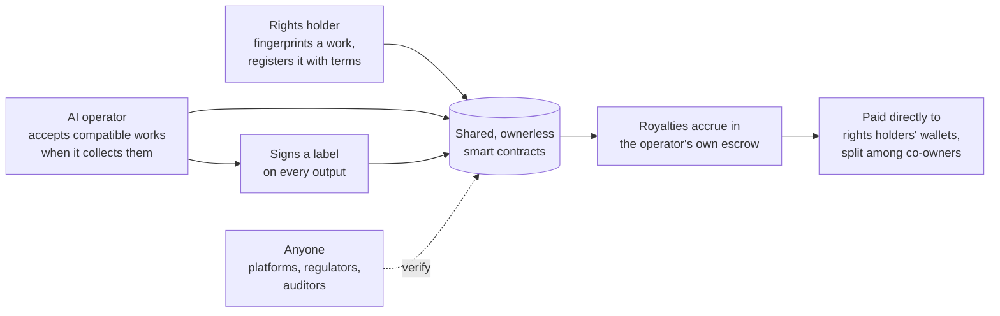

# Chain of Title

**Software for *Proof of Origin*: provenance tagging for creative works, signed labels on AI outputs, and royalties paid automatically by smart contracts.**

By **Adam Hatefi** · [Owrang Studios](https://owrang.io/studios/) · Under construction

> This is a showcase repository. It describes the project and how it is built; the source code is not included here.

---

## What it is

Generative AI is trained on, and produces work derived from, creative work whose owners are rarely asked and rarely paid. Lawsuits are slow and case-by-case, and there is no shared record of who made what, on what terms, or what an AI system actually used.

*Proof of Origin: A Blockchain Framework for Automated Copyright Enforcement in the Generative AI Era*, a paper by Adam Hatefi, proposes a fix built on three pillars. Chain of Title turns that paper into working software:

| Pillar | What the software provides |
|---|---|
| **1 · Provenance tagging** | Fingerprinting of works, registration with the owner's terms, identifiers embedded in the file (metadata, C2PA, watermarks), recovery when metadata is stripped, tamper-evident logs of scraping, and a recorded chain of title: who owns a work, and on what signed basis. |
| **2 · AI-output labeling** | A signed label (a W3C Verifiable Credential) on every AI output at the moment it's generated, anchored on-chain in batches, disclosing its lineage with method and uncertainty, and checkable by any platform. |
| **3 · Automatic royalties** | Each AI operator funds its own escrow. Royalties accrue in the same transaction that anchors its labels, and are paid directly to rights holders' wallets, split among co-owners, after a window in which payments can be challenged. |

## How it works

1. A **rights holder** fingerprints a work, registers it with its terms (what's permitted, and at what price), embeds the reference in the file and publishes it.
2. An **AI operator's** collection software looks the work up, compares its terms with the operator's own policy, accepts the compatible works automatically and excludes the rest. Each acceptance forms the license.
3. When the model **generates**, the operator signs a label for each output and anchors batches of them on-chain. The same transaction accrues the royalties owed.
4. After the **challenge window**, automated keepers pay each rights holder directly from the operator's escrow.
5. **Disputes** go up a ladder the parties agree to in advance: on-chain checks of the operator's own records, then a deterministic rulebook, then people.

Each side can deploy its half on its own. Neither needs permission from the other, and no third party is required. A nonprofit market operator or a regulator can be added later as a configuration, without re-registering any work.

## What it is not

- **Not a law.** Software can't create the paper's legal mandates or penalties. By default, the obligation to pay comes from a standard license the rights holder offers and the operator accepts on-chain. A dormant statutory mode switches on only if an authority sets a rate schedule.
- **Not a bank.** It never holds anyone's money. Payments go straight from each operator's escrow to rights holders, in an existing regulated stablecoin.
- **Not a middleman.** No contract sends a fee to the project.
- **Not a judge.** It doesn't decide title, infringement or fair use. Those stay with the people and institutions the parties choose.

## Built with

| Layer | Tools |
|---|---|
| Smart contracts | Solidity, built and tested with Foundry, with invariant testing and Halmos symbolic checks |
| Chain and settlement | Arbitrum One, settling in USDC |
| Standards | W3C Verifiable Credentials 2.0, C2PA content credentials, EIP-712 signatures, Sign-In with Ethereum |
| Libraries and services | TypeScript (pnpm and Turborepo) and Python |
| Tools for people | A static web configurator for non-technical rights holders and operators (no backend, no keys) |
| Research | A pilot harness and a non-blockchain comparison system, to produce the measurements the paper calls for before any legal mandate |

## How it's built

- **An open core and licensed operator software.** The contracts, formats, settlement and dispute libraries, and the tools for rights holders, regulators and auditors form an open core under Apache-2.0. The software AI operators run is licensed separately.
- **Specification first.** A full design specification traces every requirement back to the paper, and shared test vectors pin down each format.
- **No personal data on-chain.** Identities are pseudonymous, and the salts that link them are kept off-chain and can be deleted.

## Where it stands (November 2026)

Under construction, at its first milestone. Nothing here is ready for real funds.

---

### About this repository

This repository contains no source code.
Copyright © 2026 Adam Hatefi. All rights reserved.
Questions: [owrang.io/contact](https://owrang.io/contact/)
